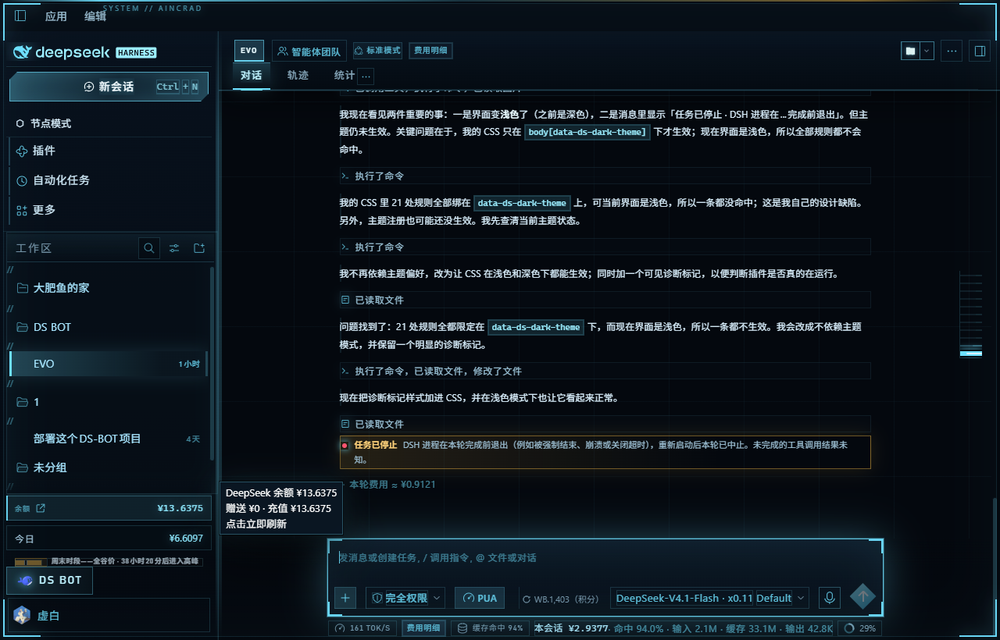
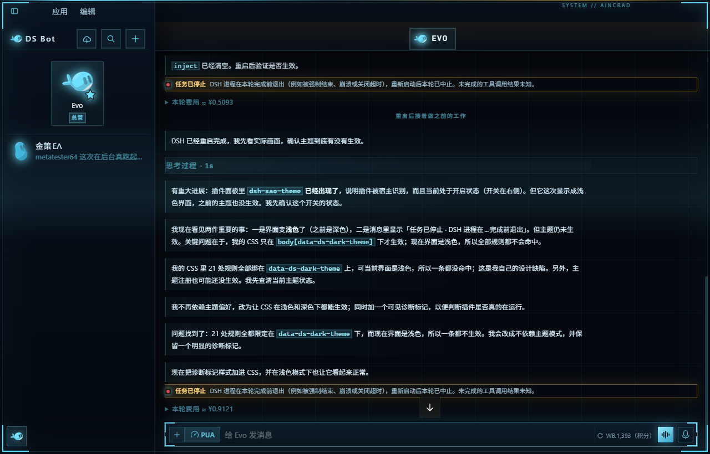
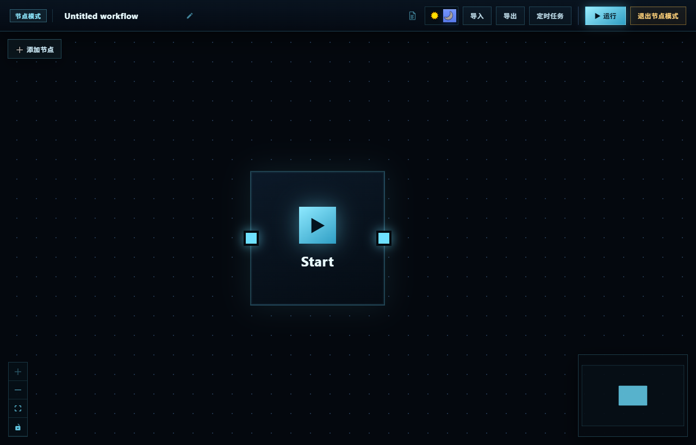

# dsh-sao-theme

给 [DeepSeek Harness](https://github.com/deepseek-ai) 桌面版套一层 **刀剑神域 / Aincrad** 风格的系统界面皮肤：
深空底色、冷青全息描边、四角括号、扫描带、等宽数字，以及像命令行窗口一样带刻线的输入区。

这套皮肤不换几组颜色了事——它把宿主的三套界面（主界面、DS Bot、节点模式）逐个改写成同一套 HUD 语言。

## 效果

主界面：



DS Bot 模式：



节点模式：



## 安装

```bash
cd ~/.dsh/profiles/desktop
pnpm add github:EN-linkes/dsh-sao-theme
```

然后确认两处：

- `package.json` 的 `dependencies` 里有 `dsh-sao-theme`
- `package.json` 的 `dsh.profile.bundles` 里有 `dsh-sao-theme`

插件自带的 `cordis.patch.yml` 会把宿主条目插进组合，不需要手写 composition。
最后**重启 DeepSeek Harness**——客户端插件只在宿主启动时加载，刷新页面无效。

本地开发可以直接指向工作副本：

```bash
pnpm add file:/path/to/dsh-sao-theme
```

> 注意：profile 里的 `node_modules/dsh-sao-theme` 是 pnpm 的硬链接副本，
> 直接改源目录不会生效，要么 `pnpm add file:` 重装，要么把 `lib/` 里的两个文件 `cp -f` 过去。

## 它做了什么

| 层 | 实现 | 说明 |
|---|---|---|
| 令牌层 | 覆盖 `--dsw-alias-*` / `--dsw-specific-*` | 主界面的配色来源，与宿主 light/dark 无关 |
| 结构层 | 按真实 DOM class 定制 | 侧栏菜单窗、顶栏标签条、工具调用记录条、输入命令行窗 |
| 细节层 | 圆角归零 / 字体三分 / 形状语言 | 见下节 |
| 子系统层 | `bt-*`（DS Bot）、`wf-*`（节点模式） | 这两块**不读 `--dsw-*` 令牌**，各自硬编码了一套配色，必须单独压制 |
| HUD 层 | 注入 `#dsh-sao-hud` | 四角括号 + 外圈细框、顶边系统线、缓慢下移的扫描带、`SYSTEM // AINCRAD` 标识 |

**为什么不注册成主题**：`ui-theme` 的第三方主题 id 只在本进程内有效、不进设置 schema，
用户在设置里看不到也选不了。所以这里直接用 `html.sao body { … !important }` 压住宿主的两套定义。

## 细节层

- **圆角全量归零**：`html.sao body *:not([role='switch'])… { border-radius: 0 !important }`。
  实测 3292 个节点里非零圆角元素从 64 个降到 **0 个**。只保留三个刻意造型：
  发送键菱形（`clip-path`）、头像六角徽记、开关/勾选/进度条的功能性圆角。
- **字体三分**：
  - 正文 `--sao-ui` = Segoe UI Variable Text → Noto Sans SC
  - 结构标签 `--sao-hud` = Bahnschrift（DIN 感）+ 宽字距 + 大写
  - 代码/数字 `--sao-mono` = Cascadia Mono / Consolas + `tabular-nums`
- **形状语言**：斜切角（`clip-path` 切 10–14px）、四角 L 形刻线（多背景层实现，不动 box model）、
  左侧 2px 刻度条、`//` 分区前缀。
- **彩色位图去色**：顶栏资源管理器图标、DS Bot 头像等 Windows 彩色位图统一 `filter` 压成青色单色。

## 子系统层

主界面用 `--dsw-*` 令牌，但 **DS Bot 模式和节点模式是两套独立组件，完全不读令牌**，
所以它们原本看起来像"另一个应用"。这两块只能逐个类名重画。

### DS Bot（`bt-*`）

原本的硬编码配色：左栏 `#1b1b1b`、气泡 `#262626`、胶囊与圆钮 `#141414`、
吉祥物 `--bt-ink-deepseek: rgb(106,132,255)` / `--bt-ink-yellow: rgb(255,152,0)`、
语音键实心 `rgb(91,123,255)`。现在的映射：

| 元素 | 处理 |
|---|---|
| `.bt-leftcol` | 换成侧栏同款深蓝渐变 + 右缘青边 |
| `.bt-bubble` | 灰板压成"半透明青渐变 + 左侧 2px 刻度"，与主界面消息语言一致 |
| `.bt-mark` / `[data-shape]` | 覆写 `--bt-ink-*` / `--bt-main` / `--bt-accent` → 吉祥物整体转青，不用改 SVG |
| `.bt-badge-main` | 星标 SVG `fill` 改青色 + 外发光 |
| `.bt-pill` `.bt-tile` `.bt-chip` `.bt-round` `.bt-plus` | 青边 HUD 方键 / 卡片 |
| `.bt-voice` | 蓝紫实心 → 青色渐变 |
| `.bt-event` / `_think` | 系统事件行 / 思考过程：宽字距 + 青色刻度 |

### 节点模式（`wf-*` + `react-flow__*`）

原本 slate 蓝底 + 青绿 `rgb(45,212,191)` + 节点绿 `rgb(52,211,153)` + 端口蓝紫 `rgb(111,143,255)`
+ 退出粉 `rgb(255,177,189)`。现在底/框/节点/端口/连线/缩略图全部转青，
「运行」改青色实心主按钮，「退出节点模式」收进琥珀警示色。

### 一个静默失效的坑

宿主给 `header.an3WzG_header` 的规则特异性高于 `html.sao .an3WzG_header`，
导致背景**静默失效**（不报错，顶栏就是透明，DS Bot 模式里正文会从顶栏底下透出来）。
要写成 `html.sao body header.an3WzG_header[data-window-drag]` 才压得住。

**规律：改完发现"颜色没生效但也没报错"，先怀疑特异性，而不是选择器写错。**

## 改样式

`lib/sao.css` 是唯一真相。改完内联进客户端包：

```bash
node build.mjs
```

`build.mjs` 会把 CSS 塞进 `lib/client.js` 的 `@sao-css` 标记区，并做两道守卫：

1. CSS 里出现反引号或 `${` 直接拒绝——它们会截断 `String.raw` 模板，
   产物语法错误、插件整体不加载，界面静默回退成宿主原生深色（这个坑踩过两次）；
2. 产物必须通过 `node --check`。

开发时可以开热更，不用反复重启：

```bash
node dev.mjs                       # 起 127.0.0.1:9700
# 客户端 URL 带 ?sao-dev，或 localStorage['sao-dev']='1'
```

### 可读性回归检查

改配色前先跑一遍，能挡住这个皮肤最容易犯的错——**填充面和文字撞色**：

```bash
npm run audit          # 四项检查，有问题退出码 1
npm run audit -- --verbose          # 展开已确认项的理由
npm run audit -- --write-baseline   # 复核后更新基线
```

它直接读 DSH 的 `app.asar`，抽出原厂 CSS 后检查：

| # | 检查 | 为什么 |
|---|---|---|
| ① | 对比度 < 3.0 | 原厂共 531 条「同时声明 background 与 color」的规则，用主题令牌解析后逐条算 |
| ② | `[class*='X']` 跨组件通配 | 一个通配命中多个组件命名空间时，很容易误伤 |
| ③ | 浅色填充但没给 `color` | 会继承浅色文字，等于白底白字 |
| ④ | `[class*='X']` + `color !important` | **真踩过的雷**，用基线快照比对新增项 |

`app.asar` 路径不是默认位置时传进去：

```bash
node tools/audit.mjs "D:/other/resources/app.asar"
```

> 血泪教训：给 `[class*='_button_1ulci_']`（DSH 公共 Button 的**基类**）统一加
> `color: 青色 !important`，结果全应用每个按钮的文字都被染成青色；主按钮底色同样是青，
> 对比度直接掉到 **1.00**，字和图标全隐形。**通配能匹配基类时，必须按变体分治**
> （`_primary_` / `_outline_` / `_ghost_`），尤其是改 `color` 这种会被继承的属性。

## 已知限制

- 结构层用的是当前版本的 CSS Modules hash 前缀（`mP3x-q`、`wtg9ga`、`an3WzG`、`V4vHZW`、
  `GRgSLq`、`hKdVjq`、`BE0jCW`、`wnFoaW`、`SNx2jG` 等）。**DSH 升级后这些前缀会变**，
  结构层会失效降级，但令牌层（配色）仍然生效——变量名是稳定的。
- 容易漂移的组件已改用属性选择器（`[class*='_markdown_']`、`[class*='_row_l4nv8_']` 等），
  哈希变了照样命中。**但属性选择器是双刃剑**：匹配到「组件基类」时会连带命中它的所有变体，
  改 `color` 尤其危险（见上面 `_button_1ulci_` 的教训）。新增样式优先锚定到具体哈希前缀，
  改完跑一次 `npm run audit`。
- 升级后要恢复固定的结构层：重跑一次 DOM 快照，把新前缀替换进 `lib/sao.css`。

## 附：`dsbot-patch/`

顺手放了两份和主题无关的补丁记录，起因是一个真实的线上 bug：

**DS Bot 对话每一轮都失败，报 `Cannot read properties of undefined (reading 'filter')`。**
根因是 DSH 0.2.2 把 `tools` 挪到 `system-prompt/assemble` 瀑布之后才拼进 assembly，
而 ds-bot 0.2.6 仍按旧形状读 `assembled.tools`，于是 `preStep` 里就抛错，第一步都进不去。

- `apply.mjs` —— 给 0.2.6 打 `Array.isArray` 守卫（上游 0.3.1 已内置同样的修法）
- `apply-menu.mjs` —— ds-bot 0.3.1 把「返回对话」收进了设置页（侧栏那个按钮改成了反方向），
  这个脚本在齿轮菜单「Bot 设置」下面补回一项「经典 Agent 模式」，一键回经典界面
- 完整的定位过程写在 `dsbot-patch/README.md`：诊断日志的 error 行不带 stack，
  真正有用的是逐帧 zstd 压缩的会话日志 + `turn/start` 之后 10ms 就 `turn/end` 这个判据

## License

MIT

版本变更见 [CHANGELOG.md](./CHANGELOG.md)。
